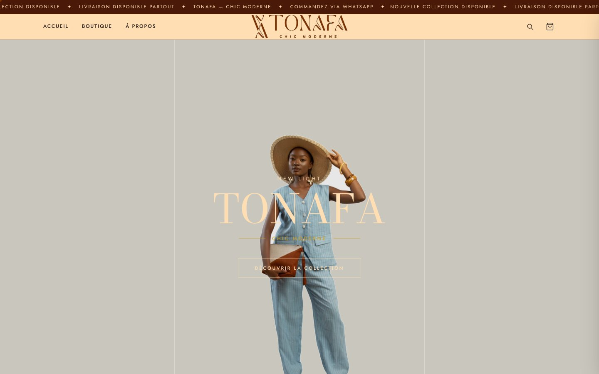
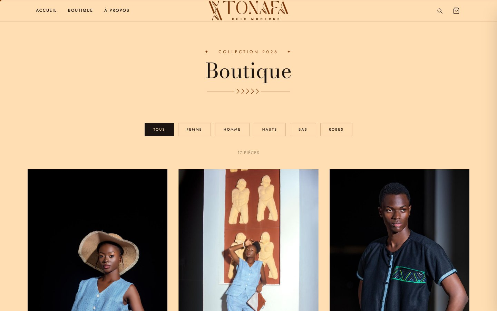
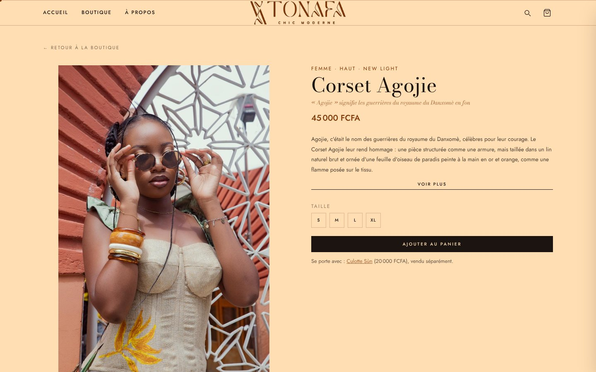
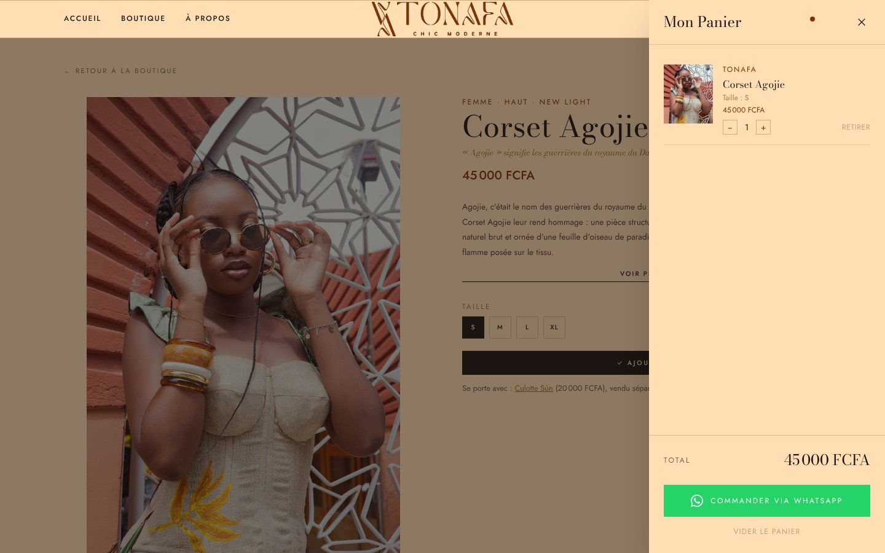
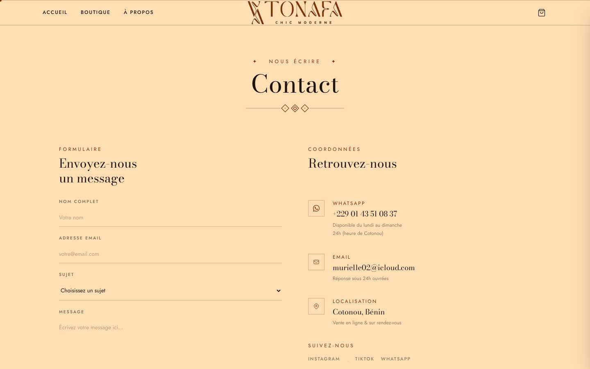
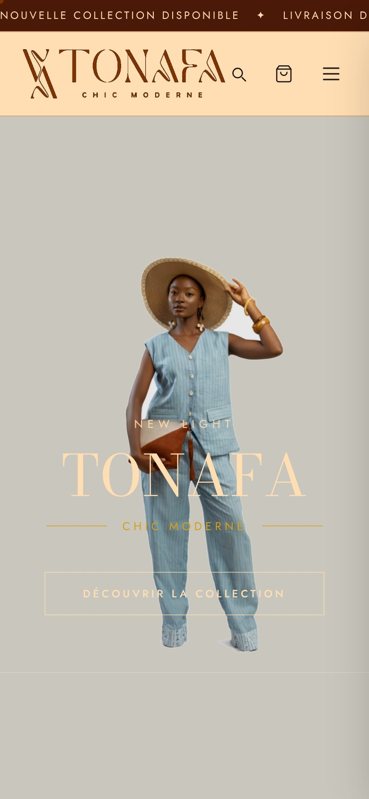

# TONAFA — Chic Moderne · E-commerce website

Showcase and online-ordering website for **TONAFA**, a Beninese ready-to-wear brand ("Chic Moderne"), developed as a freelance project and during my internship at TONAFA (July 2026).

🌐 **Live site: [tonafaofficial.com](https://tonafaofficial.com)**



## The project

TONAFA sells its collections mainly through Instagram, TikTok and WhatsApp. The goal was a premium website, consistent with the brand image. Customers had to be able to browse the collection, choose a size and order **without online payment**: the cart turns into a pre-filled WhatsApp message to the brand.

| | |
| --- | --- |
| **Client** | TONAFA, founded by Murielle GUIDI (Cotonou, Benin) |
| **Role** | design, front-end development, image processing, deployment |
| **Stack** | HTML5, Tailwind CSS, vanilla JavaScript, Three.js (one 3D section), Google Fonts |
| **Hosting** | YoupiHost shared hosting, `tonafaofficial.com` domain, HTTPS |
| **Collection** | *New Light*: 17 pieces with names in Fon, prices in FCFA |

## Features

- **5 pages:** home, shop, product page, about, contact.
- **Shop:** filters (women, men, tops, bottoms, dresses), cards generated from one catalogue file (`js/produits.js`).
- **Product page** (`produit.html?id=…`): photo gallery, story of the piece and meaning of its Fon name, size selection, "worn with" suggestions.
- **Cart** in a side drawer: sizes, quantities, total.
- **WhatsApp checkout:** the order (pieces, sizes, quantities, total) is sent as a ready-made message to the brand's number.
- **Search** across the collection.
- **Brand identity:**
  - colours: deep maroon, cognac, gold, cream;
  - fonts: *Bodoni Moda* and *Jost*;
  - logo vectorised and cut out with Python Pillow.
- **Animations:**
  - opening screen where the TONAFA monogram draws itself;
  - cream veil between pages;
  - African patterns that paint themselves on scroll, inspired by the painted hems of the clothes;
  - a piece of painted linen floating in 3D (Three.js, loaded only when the section comes into view);
  - photos revealed on scroll;
  - custom cursor.
- **Accessibility:** animations are disabled when the visitor asks the system to reduce motion (`prefers-reduced-motion`).
- **Responsive:** mobile menu, layouts adapted to phones.
- **No back-end and no build step:** the site is plain static files, so it is cheap to host and easy to maintain.

## Screenshots

| Shop | Product page |
| --- | --- |
|  |  |
| **Cart → WhatsApp order** | **About** |
|  |  |
| **Contact** | **Mobile** |
|  |  |

Full-page captures: [home](docs/screenshots/01-accueil-page-complete.jpg) · [shop](docs/screenshots/02-boutique-page-complete.jpg) · [product](docs/screenshots/03-produit-page-complete.jpg) · [about](docs/screenshots/04-a-propos-page-complete.jpg) · [contact](docs/screenshots/05-contact-page-complete.jpg)

## Structure

```
index.html          home page (hero, featured pieces, 3D linen, patterns)
boutique.html       shop with filters
produit.html        product page (?id=…)
about.html          brand story
contact.html        contact form and details
css/style.css       custom styles and animations (Tailwind handles the layout)
js/
  produits.js       catalogue: the 17 pieces (name, price, sizes, photos, description)
  boutique.js       generates product cards on the shop and home pages
  produit.js        renders a product page
  script.js         cart, WhatsApp checkout, search, menu, cursor, scroll reveals
  loader.js         opening animation (monogram drawing)
  transitions.js    page transition veil
  motifs.js         patterns painted on scroll
  lin3d.js          floating 3D linen (Three.js)
assets/img/
  logo/             logos (white, cognac, monogram)
  lifestyle/        campaign photos
  produits/         product photos, one folder per piece
```

## Run locally

No installation is needed. Open `index.html` in a browser, or serve the folder:

```bash
python -m http.server 8000      # then http://localhost:8000
```

**Adding a piece:** add an entry to `js/produits.js`, and its photos to `assets/img/produits/<id>/`. The shop, the product page and the cart pick it up automatically.

---

**Developer:** Maël Alain Bradley AZAÏNON — freelance web developer, Embedded Systems & IoT student at IFRI (Université d'Abomey-Calavi)

Brand, logos and photos © TONAFA. All rights reserved.
